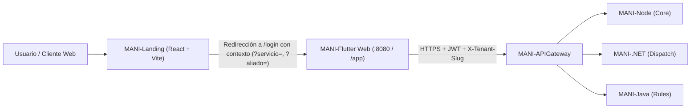

# Arquitectura e Integración — MANI-Landing

## 1. Contexto y Rol Arquitectónico

`MANI-Landing` es la capa web pública de entrada y conversión del ecosistema **MANI**. Su responsabilidad es desacoplar la experiencia informativa, de descubrimiento de catálogo y de estimación preliminar (que requiere carga instantánea, SEO y alta interactividad visual en navegadores de escritorio y móviles) del cliente transaccional multi-tenant construido en **Flutter Web** (`MANI-Flutter`).

---

## 2. Decisiones de Diseño Frontend

1. **Component-Driven Architecture (CDA)**:
   - **`src/components/common/`**: Primitivas visuales (`Button`, `Badge`, `Card`, `SectionHeading`) que encapsulan bordes, sombras y estados hover consistentes con el manual de marca.
   - **`src/components/layout/`**: Navegación principal (`Navbar`), pie de página (`Footer`) y barra de configuración del entorno Flutter (`FlutterSettingsBar`).
   - **`src/components/sections/`**: Módulos funcionales independientes por sección de negocio (`hero`, `brand`, `services`, `howItWorks`, `appPreview`, `experts`, `video`, `testimonials`, `estimator`, `cta`).
2. **Separación de Datos de Presentación (`src/constants/`)**:
   - Los catálogos de muestra, tarifas orientativas, pasos de previsualización de pantallas móviles y preguntas frecuentes se mantienen en módulos de constantes puros (`servicesData.js`, `expertsData.js`, `appScreensData.js`, `testimonialsData.js`, `brandData.js`), facilitando su mantenimiento sin tocar la lógica de renderizado.
3. **Estado Global Ligero (`src/context/AppContext.jsx`)**:
   - Administra sin dependencias externas pesadas:
     - `flutterWebUrl`: URL base activa hacia `MANI-Flutter` con sincronización en `localStorage`.
     - `isEstimatorOpen` / `activeServiceId`: control del modal de cotización rápida (`QuickEstimatorModal`).
     - `isSettingsOpen`: control del modal de configuración de conexión con Flutter Web.
     - `toastMessage`: retroalimentación visual inmediata antes de abrir o redirigir hacia la aplicación web.

---

## 3. Contrato de Redirección hacia `MANI-Flutter`

La landing solo redirige a rutas **públicas que existen** en el router de `MANI-Flutter` (`lib/core/routing/app_router.dart`). El visitante llega sin sesión: una ruta privada lo mandaría a `/login` y go_router descartaría la consulta. Por eso el contexto viaja como parámetros de consulta de `/login`, que la URL conserva. `src/utils/flutterRoutes.js` es la única fuente del contrato: `rutaFlutter()` arma la ruta y `urlFlutter()` la une con la URL base, sin barras dobles.

| Acción en la landing | Ruta en `MANI-Flutter` |
| :--- | :--- |
| Ingresar a la app (CTA generales) | `<flutterWebUrl>` (Flutter redirige `/` a `/login`) |
| Explorar una categoría | `<flutterWebUrl>/login?servicio=<serviceId>` |
| Continuar desde el estimador | `<flutterWebUrl>/login?servicio=<serviceId>&urgencia=<hoy\|manana\|programado>&alcance=<sencillo\|medio\|amplio>` |
| Reservar con un aliado destacado | `<flutterWebUrl>/login?aliado=<expertId>` |

- Solo se envían `servicio`, `urgencia`, `alcance` y `aliado`. Nunca viajan datos personales, tenant ni credenciales.
- Hoy Flutter ignora estos parámetros; quedan en la URL para que la app los use cuando tenga la historia correspondiente. Las rutas `/booking` y `/experts/<id>` que usaba la versión anterior no existen en Flutter y se retiraron.
- Prueba del contrato: `npm test` (`tests/flutterRoutes.test.js`). Con `MANI_FLUTTER_ROUTER=<ruta a app_router.dart>` también comprueba que cada ruta esté declarada en el router de Flutter.

La imagen Docker recibe `VITE_FLUTTER_WEB_URL` como `--build-arg` desde la variable `FLUTTER_WEB_URL` del GitHub Environment de cada rama (README §6). Si no llega, `src/config/flutterWebUrl.js` resuelve el respaldo para no apuntar por error a `localhost:8080` en entornos desplegados: con la landing en un puerto propio (`:3001` en DEV/QA/PROD) usa el mismo host en `:8080`; en el puerto estándar (despliegue unificado, §5) usa `${window.location.origin}/app`.

---

## 4. Calidad y Construcción

- **Linter**: `oxlint` (`npm run lint`) valida reglas de React, hooks e importaciones en menos de 100 ms.
- **Bundler**: `vite build` (`npm run build`) empaqueta y minifica los recursos estáticos en `dist/` con soporte nativo para ES Modules.
- **Pruebas**: `npm test` corre con `node:test`, sin dependencias nuevas. Cubre el catálogo con tarifa base (CA-1), el cálculo del rango y el aviso del estimador (CA-2), y el contrato de redirección (CA-3).
- **Estimador** (`src/utils/estimator.js`): rango = tarifa base × factor de urgencia × factor de alcance; el máximo lleva un margen de ×1,5 y ambos valores se redondean a miles de COP. Es una referencia, **no una cotización formal**, y el modal lo dice explícitamente.

---

## 5. Topología de Despliegue Unificado (`/` + `/app/`)

En entornos integrados (Nginx / Cloudflare Workers), ambos artefactos estáticos se ensamblan bajo un mismo origen para evitar fricción de CORS y compartir dominio público:

1. **Raíz (`/`)**: sirve el bundle compilado de `MANI-Landing/dist` con `Cache-Control: no-cache, no-store, must-revalidate` en `index.html`.
2. **Subruta (`/app/`)**: sirve la compilación de `MANI-Flutter` generada con `flutter build web --release --base-href /app/`.
3. **Fallback SPA dual**:
   - Cualquier ruta bajo `/app/*` no encontrada en estáticos resuelve a `/app/index.html` (router de Flutter Web).
   - Cualquier otra ruta bajo `/*` resuelve a `/index.html` (Landing Page).

